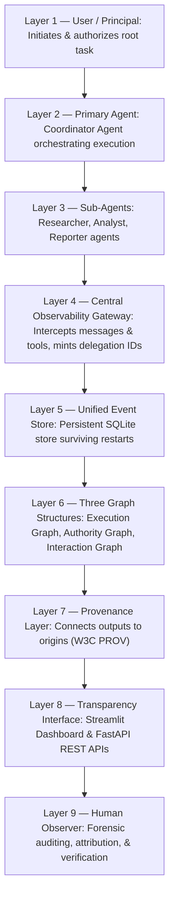
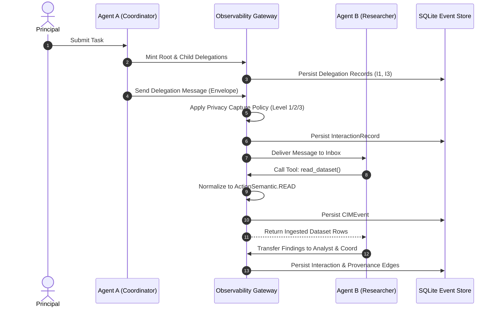

# System Architecture

## 1. 9-Layer Hierarchical Stack

The platform implements the complete 9-layer architecture specified in *RM_MID.pdf* (Slide 11):

---

## 2. Component Structure

### 2.1 Four Specialized LangGraph Agents
- **Agent A (Coordinator):** Decomposes user tasks, mints root and sub-delegations, handles clarification requests from peers, and coordinates final synthesis.
- **Agent B (Research Agent):** Ingests allowlisted datasets (`data/samples/`), extracts records through instrumented tool calls, and transfers structured findings.
- **Agent C (Analysis Agent):** Performs statistical computations, sentiment breakdowns, or security access audits through permitted tools, and requests clarification when needed.
- **Agent D (Report Agent):** Synthesizes executive Markdown reports with explicit provenance footnotes and persists final artifacts.

### 2.2 Central Observability Gateway
The gateway sits at the controlled boundary:
1. **Delegation Minting & Binding (Invariants I1, I3, I5):** Authoritatively generates unforgeable delegation tokens (`del_...`) bound to authenticated principals.
2. **Action Semantic Normalization (Invariant I4):** Maps native operations into Tier-1 verbs (`read`, `write`, `search`, `share`, `invoke`) and Tier-2 qualifiers.
3. **Inter-Agent Message Interception:** Captures message envelopes across 9 interaction types and enforces privacy-aware capture policies.
4. **Tool Execution Mediation:** Records before/after CIM telemetry with microsecond latency accounting.

### 2.3 Persistent Unified Event Store (SQLite)
Thread-safe, WAL-enabled storage with normalized relations:
- `workflow_runs`: Execution runs and state lifecycle.
- `delegations`: Authority DAG with parent-child lineage closure.
- `interactions`: Inter-agent communication records.
- `execution_events`: CIM tool and span events.
- `artifacts`: Generated reports and outputs.
- `provenance_edges`: Explicit W3C PROV evidence links.

### 2.4 The Three-Graph Transparency Model
- **Execution Graph ($G_{exec}$):** Causal trace/span DAG. Answers: *"What happened?"*
- **Authority Graph ($G_{auth}$):** Delegation hierarchy DAG. Answers: *"Under whose authority?"*
- **Interaction Graph ($G_{interact}$):** MultiDiGraph of agent-to-agent communication. Answers: *"Who communicated with whom, what was exchanged, and what happened next?"*
- **Provenance Layer:** Evidence DAG linking outputs back to data sources.

### 2.5 LangGraph StateGraph Orchestration & Workload Topologies
Compiled via [`StateGraph`](backend/orchestration/langgraph_workflow.py) with `MemorySaver` checkpointer:
1. **Adaptive Multi-Agent Collaboration (Default):** Bi-directional clarification, security escalation, formal handoffs, and provenance compilation.
2. **W1 Parallel Disconnected Subtasks (Paper Section 7.2.1):** Parallel concurrent reads across disparate tools under a single root delegation, proving $|Comp(d)| > 1$ before a fan-in join.
3. **W3 Trial-and-Adapt / Retries (Paper Section 7.2.1):** Dynamic parameter adaptation, backtracking, and retry logging upon intermediate observations.
4. **Dynamic Introspection:** Generates live Mermaid flowcharts and Graphviz DOT topologies directly from compiled graph objects.

---

## 3. Event Recording Workflow

